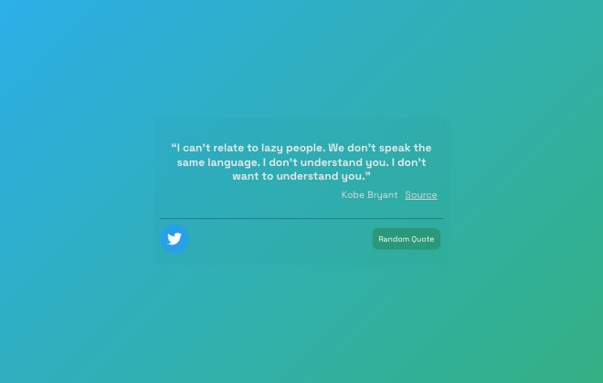

# Random Quote Machine

A React app that displays Kobe Bryant quotes and builds a share link for X.

I built this project in February 2022 while learning React.



## Run locally

Use Node.js 24 and npm.

```sh
npm ci
npm start
```

Open `http://localhost:3000/random-quote-machine/`. Use **Random Quote** to see another quote, **Source** to see its attribution, or the share button to open a post draft on X.

```sh
CI=true npm test -- --watchAll=false --runInBand
npm run build
```

## Quote sources

- The quote about relating to lazy people comes from [Lee Jenkins's Sports Illustrated interview](https://www.si.com/nba/2013/10/16/kobe-bryant-lakers-si-cover-story).
- The quote about rising to challenges appears on [Nike's Mamba Mentality page](https://www.nike.com/mamba-mentality/optimism).

## Built with

React 17, Create React App, and react-social-icons. The interface uses the Space Grotesk font via Google Fonts.

## GitHub Pages

The production build targets [ntpon.github.io/random-quote-machine](https://ntpon.github.io/random-quote-machine/). The repository owner can use `npm run deploy` to publish the build to the `gh-pages` branch and select that branch and its root as the Pages source.

## License

The original application code is available under the [MIT License](LICENSE). Quotes and third-party assets retain their respective rights.
